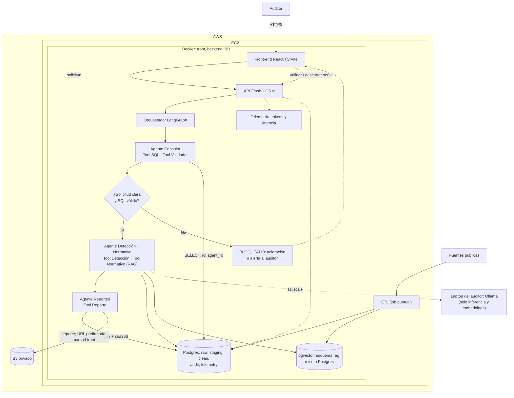

# Arquitectura v2: Agente Auditor de Contrataciones Públicas

> Versión regenerada tras las decisiones del equipo. Diagrama: `arquitectura_v2.png` (editable en `arquitectura_v2.dot`).
> Lo que está marcado como **PENDIENTE** son decisiones o datos que aún no están confirmados.

## 1. Decisiones vigentes y su implicación

| Decisión | Implicación |
|---|---|
| Los modelos LLM corren **en local** (laptop de cada auditor) | Hay que fijar un hardware mínimo y los modelos permitidos; los resultados pueden variar entre equipos |
| Front, backend y BD en la **nube (EC2)** | Postgres no se expone a internet; hay que respaldar el volumen |
| Docker solo para **backend, front y BD** | El agente local se instala aparte (carpeta `agent_host/` con su guía) |
| **Opción A:** en la laptop corre **solo Ollama** (inferencia y embeddings) | La lógica de negocio, las tools y las credenciales están en el backend; la laptop no tiene acceso a la BD |
| El **orquestador** (LangGraph) es parte del backend | Un solo servicio coordina el flujo, el estado del caso y la bitácora |
| **3 agentes:** consulta, detección + normativo, reportes | Dentro del agente 2, la detección es la Tool 1 y el normativo la Tool 2, con orden fijo |
| Reportes finales en **S3**; la BD guarda la ruta | Bucket privado, rol IAM, hash del reporte en la BD |
| **Tailscale** para conectar backend y laptops | ACLs por etiqueta; manejo de agente apagado |

## 2. Diagrama

Versión en Mermaid (se renderiza en GitHub y en VS Code con la extensión):

## 3. Componentes y responsabilidades

| Componente | Dónde corre | Tipo | Responsabilidad |
|---|---|---|---|
| Front-end (React, TS, Vite) | EC2, contenedor | Interfaz | Captura la solicitud, muestra reportes y trazas, registra la decisión humana |
| Backend (Flask) | EC2, contenedor | Determinista | API, control de acceso, persistencia de casos y bitácora, subida a S3 |
| Orquestador (LangGraph) | Dentro del backend | Determinista | Flujo fijo entre agentes, estado del caso, reintentos, bloqueos |
| Agente Consulta | Lógica en el backend; inferencia en la laptop | LLM + validador de SQL | Traduce la solicitud a SQL sobre vistas aprobadas y lo ejecuta con `agent_ro` |
| Agente Detección + Normativo | Lógica en el backend; inferencia en la laptop | Tool 1 determinista; Tool 2 LLM + RAG | Tool 1: reglas de riesgo con umbrales definidos. Tool 2: normas vigentes por señal, o declara que no hay soporte |
| Agente Reportes | Lógica en el backend; inferencia en la laptop | LLM con plantilla | Redacta el reporte con evidencia, normas y limitaciones; lo sube a S3 |
| Ollama (laptop) | Laptop del auditor | Inferencia | Solo genera texto y embeddings. Sin lógica de negocio ni credenciales |
| Postgres + pgvector | EC2, contenedor con volumen EBS | Datos | Capas `raw`, `staging`, `clean`; esquemas `rag`, `audit`, `telemetry` |
| S3 | AWS | Almacenamiento | Reportes finales (privado, cifrado) |
| ETL | Job de Python y SQL (no es un servicio permanente) | Determinista | Limpia y carga las fuentes públicas en la BD y el RAG |

**Principio que se conserva:** el LLM interpreta, selecciona fragmentos y redacta. No calcula montos, no define umbrales y no aprueba consultas; eso lo hacen las tools deterministas y el validador.

## 4. Flujo de un caso

1. El auditor captura la pregunta en el front; el backend crea el caso (estado `recibido`).
2. El orquestador llama al **Agente Consulta**: el modelo local genera el SQL, el **backend** lo valida (solo `SELECT`, vistas aprobadas, límite de filas y de tiempo) y lo ejecuta con `agent_ro` (`consultado`).
3. El **Agente Detección + Normativo** ejecuta la Tool 1 (reglas de riesgo) y marca las señales (`detectado`).
4. La Tool 2 recupera las normas vigentes para la fecha del contrato desde pgvector y filtra por versión; si no hay soporte, lo declara (`normado`).
5. El **Agente Reportes** redacta el reporte con plantilla, lo guarda en S3 y escribe en la BD la ruta, el hash y la versión (`reportado`).
6. El auditor valida, descarta o deja pendiente cada señal (`en_revision` → `cerrado`).
7. Cualquier fallo, ambigüedad o agente apagado deja el caso en `BLOQUEADO`, con el motivo registrado.

La bitácora guarda en cada paso: solicitud, SQL, fuentes, normas, modelo exacto y cuantización, versión de Ollama, equipo que ejecutó, tokens y latencia.

## 5. Red y seguridad

- **Tailscale:** el backend (el host de EC2) es un nodo de la red. Usa **etiquetas y ACLs**: el backend puede llegar a los agentes; los agentes no pueden hablar entre sí. Comprueba que el contenedor del backend alcanza las direcciones `100.x.x.x`.
- **Ollama no tiene autenticación.** En Windows solo escucha en `localhost` por defecto; para aceptar tráfico de la red Tailscale hay que cambiar `OLLAMA_HOST` y **limitarlo con el firewall a la interfaz de Tailscale**. La ACL y el firewall son la única protección.
- **El SQL se valida y ejecuta en el servidor.** La laptop nunca se conecta a Postgres. El puerto 5432 no está abierto a internet.
- **El backend no confía en la salida del modelo:** valida el formato contra un esquema y regenera una vez; trata el contenido recuperado como dato, no como instrucción.
- **S3:** bucket privado con el acceso público bloqueado, cifrado, rol IAM en la instancia (sin claves en archivos) y descargas con URL prefirmada.
- **Secretos** fuera del repo y del `.env` de la instancia, en el almacén de secretos de AWS si es posible. HTTPS en front y backend, con roles de acceso.
- **Respaldos:** `pg_dump` periódico a S3 y volumen EBS persistente.
- **Privacidad:** los resultados pueden incluir personas físicas; los reportes muestran la situación vigente y la fecha, y usan lenguaje de señal, no de culpa.

## 6. Datos y límites que el sistema debe declarar

- **Fuentes:** ComprasMX 2026 (84,676 registros), CompraNet histórico (2,356,609) y listado 69-B (14,837).
- **Dependencia, ramo y RFC solo existen en ComprasMX.** En el histórico quedan nulos; las preguntas por dependencia solo cubren 2026. **PENDIENTE:** confirmar con el socio formador si existe otro recurso para el histórico.
- **Cobertura temporal:** el histórico llega a 2024 con caída fuerte en 2023 y 2024; **no hay datos de 2025**. El agente debe responder "sin datos para ese periodo", nunca un cero.
- **Cruce con el 69-B:** por RFC solo es posible en ComprasMX; por nombre, siempre con baja confianza y revisión humana.
- **Normatividad:** la LAASSP de 2025 y la anterior conviven en el corpus; se filtra por la fecha del contrato. El mismo número de artículo puede pertenecer a leyes o versiones distintas. **PENDIENTE:** lista de normas prioritarias y validación por el área legal.

## 7. Riesgos nuevos y mitigaciones

| Riesgo | Mitigación |
|---|---|
| Laptop apagada o dormida | Verificación de estado, tiempo de espera y caso `BLOQUEADO` con mensaje claro |
| Hardware desigual entre laptops | Hardware mínimo y lista de modelos permitidos; registrar modelo y equipo en cada ejecución |
| Resultados distintos entre equipos | Temperatura 0, mismo modelo y cuantización fijados, golden set de pruebas por equipo |
| Ollama expuesto en la red | ACL de Tailscale y firewall limitado a la interfaz de Tailscale |
| Pérdida de datos de la BD | Volumen persistente y respaldos a S3 |
| Rutas en la BD que apuntan a reportes inexistentes | Subir a S3 primero y registrar en la BD después; verificar el hash |
| Modelo local pequeño con poca exactitud de SQL | Vistas simples con comentarios, ejemplos en el prompt y medición con el golden set |

## 8. Decisiones abiertas

1. ¿Cuál es el hardware mínimo y qué modelos se permiten?
2. ¿Quién administra la red de Tailscale y con qué plan?
3. ¿Postgres en contenedor o en un servicio gestionado, a mediano plazo?
4. ¿Qué rol puede acceder a qué (auditor, analista, legal, directivo)? ¿Habrá auditorías externas con acceso?
5. Las preguntas pendientes con el socio formador sobre dependencia en el histórico, clasificación de etiquetas "otro" y cobertura de 2025.

## 9. Cambios respecto a la versión anterior

- De 4 a **3 agentes** (detección y normativo se unen).
- El **orquestador** pasa de componente separado a parte del backend.
- Ollama sale de Docker y vive en la laptop del auditor, solo para inferencia.
- Se agregan **S3**, **Tailscale** y la separación nube / local.
- Se agregan telemetría y el registro de hardware y modelo en la bitácora.
