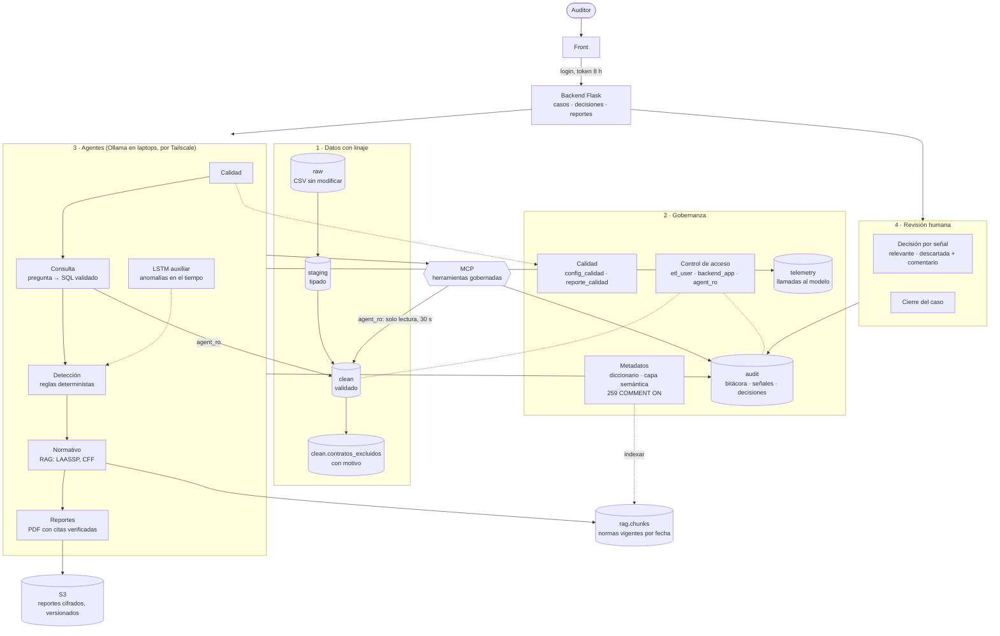

# Data Steward agéntico de contrataciones públicas

> **En una frase:** el sistema garantiza que los datos de contrataciones sean **confiables,
> trazables y de acceso controlado**, y sobre esos datos emite **señales de riesgo explicables**
> que una persona revisa y decide.

No es un "detector de fraude". Es un Data Steward (Opción 2 del reto) aplicado al dominio de las
contrataciones públicas: gobierna los datos (calidad, significado, linaje, acceso) y deja registrada
cada decisión con una persona responsable. La detección de riesgos es lo que el Data Steward hace
*sobre* datos ya gobernados.

## 1. Diagrama

Leyenda: **línea continua** = existe y funciona; **línea punteada** = en construcción (ver §4).

## 2. Los pilares de Data Steward y dónde se cumplen

| Pilar | Qué hace el sistema | Evidencia en el repo | Estado |
|---|---|---|---|
| **Calidad de datos** | Reglas de validación en el ETL; los registros que no pasan se excluyen *con su motivo*, no se borran | `clean.config_calidad`, `clean.contratos_excluidos`, [reporte_calidad.md](reporte_calidad.md); Detección reporta `calidad`, `excluidos` y `contradicciones` | Hecho (ETL). Falta como etapa del caso → **Agente de Calidad** |
| **Metadatos y significado** | Cada tabla y columna tiene descripción; el Agente Consulta la usa para generar SQL | [diccionario_datos.md](diccionario_datos.md), [capa_semantica.md](capa_semantica.md), 259 `COMMENT ON` en `etl/sql/` | Hecho. Falta indexarlos en el RAG |
| **Linaje** | `raw` (fuente intacta) → `staging` → `clean`; cada fila conserva `fuente` y `_source_file` | `etl/sql/02_raw.sql` a `07_fase4b_transform.sql` | Hecho |
| **Cobertura declarada** | El sistema avisa cuando un periodo está incompleto (p. ej. 2023, 2024) en vez de responder como si estuviera completo | `agents/consulta/coverage.py` | Hecho |
| **Control de acceso** | Mínimo privilegio: el ETL no toca `audit`, el backend no lee `clean`, el SQL de los agentes es de solo lectura y se corta a los 30 s; usuarios con rol auditor/admin | `16_rol_backend.sql`, `17_revocar_audit_etl.sql`, `18_audit_usuarios.sql`, [acceso-bd.md](acceso-bd.md) | Hecho |
| **Trazabilidad** | Cada caso guarda la solicitud, el SQL generado y ejecutado, las reglas evaluadas, las normas citadas, cada llamada al modelo y cada decisión, con usuario y hora | `audit.bitacora`, `telemetry.llm_calls` ligada al caso, [contratos/evento_bitacora.md](contratos/evento_bitacora.md) | Hecho |
| **Revisión humana** | El auditor decide cada señal; descartar exige comentario; un caso no se cierra con señales pendientes | `POST /casos/<id>/senales/<id>/decision` ([api.md](api.md)) | Hecho (falta en el front) |
| **Explicabilidad** | Cada señal trae criterio, umbral, valores calculados y confianza; el reporte solo cita normas recuperadas y un verificador rechaza citas inventadas y términos como "fraude" | `agente_deteccion/`, `agente_reporte/verificador.py` | Hecho |
| **Acceso controlado a herramientas (MCP)** | Los agentes usan herramientas gobernadas y auditadas en lugar de tocar la base directamente; ninguna herramienta decide señales | `backend/herramientas/`, [mcp.md](mcp.md) | Hecho (falta conectarlo al orquestador) |
| **Modelo auxiliar (LSTM)** | Detecta anomalías en series de montos y adjudicaciones por proveedor o dependencia | — | **Falta** |
| **Orquestación (LangGraph)** | Un grafo con un nodo por agente; la revisión humana es una interrupción del grafo | Orquestador de demo en `backend/demo/` (recorrido fijo) | **Parcial** |

## 3. Cómo se cuenta (guion de 1 minuto)

1. **El problema:** los datos públicos de contrataciones vienen de varias fuentes, con huecos,
   duplicados y fechas incoherentes. Sacar conclusiones de ellos sin gobernarlos es arriesgado.
2. **Lo que hacemos primero es gobernar:** separamos el dato original del validado (linaje), medimos
   su calidad, documentamos qué significa cada campo y limitamos quién puede leer o escribir qué.
3. **Sobre datos gobernados, los agentes trabajan con reglas explícitas:** el auditor pregunta en
   español, el agente genera SQL de solo lectura, las reglas detectan señales y el RAG cita la norma
   vigente a la fecha del contrato.
4. **Nada se decide solo:** cada señal la revisa una persona, y todo (pregunta, SQL, reglas, modelo,
   decisión) queda en la bitácora.
5. **Lo que el sistema nunca dice:** "fraude". Dice "señal de riesgo que requiere revisión" y declara
   sus limitaciones.

## 4. Lo que falta, en orden

| # | Trabajo | Responsable | Días |
|---|---|---|---|
| 1 | Este documento y el diagrama en la presentación | Equipo | 1 |
| 2 | **Agente de Calidad** como primera etapa del caso, con evento `calidad_evaluada` en la bitácora | Mario + Emiliano | 2–3 |
| 3 | ~~Servidor MCP~~ hecho ([mcp.md](mcp.md)); falta que el orquestador lo use | Emiliano, Ana Pau | — |
| 4 | **RAG de gobernanza:** indexar diccionario, capa semántica y reporte de calidad | Aarón | 1–2 |
| 5 | **LSTM auxiliar:** señal `ANOMALIA_TEMPORAL` a partir de series mensuales (2011–2022) | Por definir (requiere GPU) | 3–4 |
| 6 | **LangGraph:** reemplazar el orquestador de demo | Ana Pau | En paralelo |
| 7 | Front: decisión por señal y descarga del reporte | Front | 2 |
