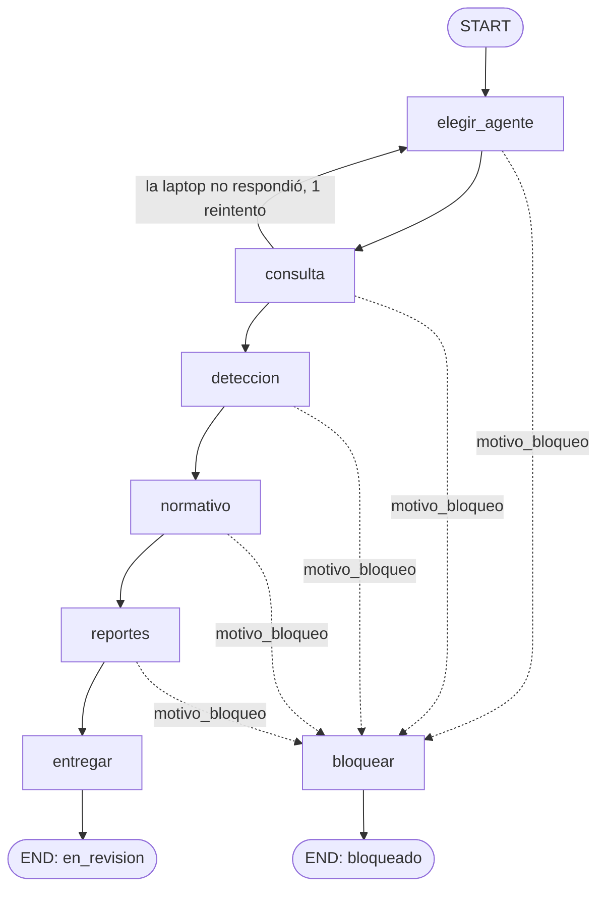

# Orquestador (LangGraph)

Código en `backend/orquestador/`. Pruebas en `tests/test_orquestador.py`. Reemplaza al
orquestador de demo (`backend/demo/`), que sigue existiendo mientras el front use `/demo/*`.

## 1. ¿Qué es un orquestador?

Los 3 agentes ya saben hacer su trabajo por separado. El orquestador es el **jefe de obra**: no
hace el trabajo de nadie, solo decide **quién va después de quién**, **qué pasa si algo falla** y
**anota todo**. En este proyecto el orden es fijo:

```
Consulta  →  Detección (Tool 1)  →  Normativo (Tool 2)  →  Reportes
```

Lo difícil no es el camino feliz, sino los desvíos: la laptop se apaga, el modelo no entiende la
pregunta, no hay datos de 2025, un fragmento de ley trae texto raro, el caso tarda demasiado… En
todos esos casos el caso debe terminar en `bloqueado` **con un motivo que el auditor entienda**,
nunca a medias.

## 2. LangGraph en 3 ideas

1. **Estado**: un diccionario que viaja por todo el grafo (`estado.py`). Lleva el `caso_id`, la
   laptop elegida, las filas de la consulta, el JSON de detección, el reporte, los avisos…
2. **Nodos**: funciones `estado -> cambios`. Cada etapa es un nodo (`nodos.py`). Un nodo devuelve
   *solo* lo que cambió; LangGraph lo mezcla con el estado. Las listas marcadas con
   `Annotated[list, operator.add]` (`completadas`, `parciales`) se van acumulando.
3. **Aristas**: qué nodo sigue. Las "condicionales" son funciones que miran el estado y devuelven
   el nombre del siguiente nodo (`RUTAS` en `grafo.py`). Así se hace el desvío a `bloquear` y el
   reintento.



## 3. Qué hace cada nodo

| Nodo | Llama a | Estado del caso al terminar | Si falla |
|---|---|---|---|
| `elegir_agente` | `seleccionar_agente` (verifica la laptop en ese momento) | — | Bloquea con el mensaje de `AgenteNoDisponible` (dice qué laptop y qué hacer) |
| `consulta` | `agents.consulta.answer_question` (ya reintenta 1 vez SQL inválido o fuera de formato) | `consultado` | Laptop caída → vuelve a `elegir_agente` una vez; aclaración / sin datos / SQL inválido → bloquea con "Información insuficiente…" |
| `deteccion` | `agente_deteccion.ejecutar` **sin** normas | `detectado` | 0 filas → bloquea ("no significa que no haya riesgo"); contradicciones → sigue con aviso |
| `normativo` | `recuperar_normas` + RAG | `normado` | Sin RAG o búsqueda fallida → sigue y lo declara en `sin_norma_aplicable`; fragmento con instrucciones → se descarta |
| `reportes` | `etapa_reportes` (PDF + S3 + hash) | `reportado` | Laptop apagada → narrativas de respaldo (deterministas) y aviso |
| `entregar` | — | `en_revision` | Registra los avisos de resultado parcial |
| `bloquear` | `repo.transitar(..., "bloqueado", motivo)` | `bloqueado` | Agrega al motivo qué etapas sí terminaron |

Todos los nodos (menos `bloquear`) pasan por `vigilar()`, que antes de correr el nodo revisa el
**límite de pasos** y el **límite de tiempo**, y convierte cualquier excepción en un motivo de
bloqueo (y un evento `error` en la bitácora). Un nodo nunca deja el caso a medias.

## 4. Cómo se usa

```powershell
# Instalar LangGraph en el backend (ya está en backend/requirements.txt, fijado en 1.2.24)
docker compose build backend

# Desde la terminal, igual que el demo
docker compose exec backend python -m backend.orquestador --solicitud "Contratos de 2026 con proveedores en el 69-B" --usuario ana
docker compose exec backend python -m backend.orquestador <caso_id>
docker compose exec backend python -m backend.orquestador --dibujar   # el grafo en Mermaid

# Desde el front
POST /casos/<id>/orquestar     -> 202, y el front sigue /casos/<id> y su bitácora
     {"narrativa_llm": false}  -> reporte con narrativas de respaldo (lo que usa el front)
GET  /casos/<id>/resultados    -> filas de la consulta, para la tabla
```

Límites (variables de entorno, opcionales):

| Variable | Defecto | Qué limita |
|---|---|---|
| `ORQ_MAX_PASOS` | 12 | Nodos ejecutados por caso (un recorrido normal usa 6) |
| `ORQ_TIEMPO_MAX_S` | 900 | Tiempo total del caso; se revisa antes de cada nodo |
| `ORQ_MAX_SELECCIONES_AGENTE` | 2 | Veces que se elige laptop (2 = un reintento) |
| `LLM_TIMEOUT_S` | 120 | (ya existía) tiempo por llamada al modelo |

Pruebas (no necesitan BD ni Ollama):

```powershell
python -m pytest tests/test_orquestador.py -v
```

## 5. Tareas O1–O8

| ID | Dónde queda | Prueba |
|---|---|---|
| O1 Grafo con estados, reintentos y BLOQUEADO | `grafo.py`, `nodos.py` | `FlujoCompletoTest`, `GrafoTest` |
| O2 Cliente de modelos y bitácora | `ClienteConBitacora` en cada llamada (evento `llamada_llm` + telemetría) | `test_llamadas_al_modelo_quedan_con_equipo_y_modelo` |
| O3 Integración con los 3 agentes | `dependencias.py` (reusa las etapas del demo) | Falta correrlo de punta a punta con BD y Ollama reales |
| O4 Límite de pasos y tiempo, parciales marcados | `vigilar()`, `Limites`, `nodo_bloquear` | `LimitesTest` |
| O5 Agente apagado | `elegir_agente`, reintento en `consulta`, respaldo en `reportes` | `AgenteApagadoTest` (falta la prueba con Ollama apagado de verdad) |
| O6 Contenido como dato | `apartar_fragmentos_sospechosos`, `ClienteBlindado` | `ContenidoComoDatoTest` |
| O7 Escenarios 5 y 6 | Mensajes "Información insuficiente…" y avisos de contradicción | `EscenariosTest` (falta la evidencia en `eval/results/` con datos reales) |
| O8 Pruebas de punta a punta | — | Pendiente: requiere el entorno completo |

## 6. Decisiones para el equipo

- **Evento de "resultado parcial".** La BD solo acepta los tipos de evento del contrato (CHECK).
  Por ahora los avisos se guardan como `error` con `tipo: "resultado_parcial"` (y
  `tipo: "contenido_sospechoso"` para O6). Si prefieren un tipo propio, hay que agregarlo al
  contrato 5, a `bitacora.py` y a `11_audit_bitacora.sql`.
- **`entregar` no revisa el límite de tiempo** (ajuste del 24 nov). Solo corre si el reporte ya se
  guardó; antes, un Agente Reportes lento dejaba el caso `bloqueado` con el reporte terminado.
- **Búsquedas normativas fallidas: un solo evento** `error` con el conteo (`busquedas_fallidas`),
  no uno por señal.
- **Cada caso calcula sus embeddings en su propia laptop** (`recuperador_para`), sin escribir
  `OLLAMA_EMBED_BASE_URL` en el entorno, que es compartido por todos los casos del proceso.
- **El límite de tiempo no corta un nodo a la mitad.** Python no puede matar un hilo; el corte
  real dentro de un nodo lo da `LLM_TIMEOUT_S` por llamada. Si el Agente Reportes hace muchas
  llamadas con la laptop lenta, puede pasar el límite y se notará hasta el siguiente nodo.
- **El hilo vive dentro del proceso de Flask.** Si el backend se reinicia a mitad de un caso, el
  caso queda en su último estado. Para el alcance del proyecto basta; para más adelante, una cola
  (RQ/Celery) o el checkpointer de LangGraph.
- **Fragmentos sospechosos se descartan, no se "limpian".** Un fragmento de ley con instrucciones
  es un problema del corpus; se avisa para que Aarón lo revise.
